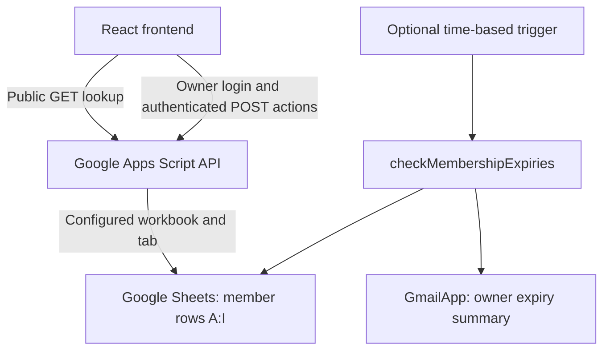

# FitZone Gym — Membership Management System

FitZone is a gym membership application with a React frontend, a Google Apps Script API, and Google Sheets storage. Members can check their membership by ID, while the gym owner can manage records and renewals through an authenticated dashboard. An optional Apps Script trigger sends expiry summaries to the owner.

The current model is **one installation per gym**, with one owner account and one configured spreadsheet tab. Multi-tenant accounts, payments, attendance tracking, and member logins are not implemented.

**Deployment status:** The repository includes a newer Owner ID/password authentication implementation that the project documentation marks as **not deployed**. The checked-in `docs/` frontend assets are from an older release. Local tests use mocked Google services; real Google staging acceptance remains outstanding. Do not assume the published application matches the current source.

[Published application link](https://yellankikaushik.github.io/Gym-Membership/) · [Owner authentication setup](backend/OWNER_AUTH_SETUP.md) · [Staging procedure and evidence](docs/AUTH_STAGING_VALIDATION.md)

## Features

### Public member lookup

- Search using a Member ID, such as `001`, without owner authentication.
- View the member's name, masked phone, membership plan, expiry date, and Active/Expired status.
- See remaining days for active memberships.
- Browse the gym gallery and open the location link.
- Public responses exclude age and weight.

### Owner dashboard

- Sign in with a case-sensitive Owner ID and password.
- View total, active, and expired member counts.
- Search by ID, name, or phone; filter by membership status.
- Browse results in pages of 10 members. Filtering and pagination operate on the downloaded list.
- Add and edit name, phone, age, weight, plan, and start date.
- Renew a membership using a selected plan and new start date.
- Delete a member after confirmation, or manually refresh the list.
- Sign out and automatically end the session at its absolute expiry.

Supported plans are `3 Months`, `6 Months`, and `1 Year`. The backend calculates end dates and derives status when records are read. A membership remains Active on its expiry date and becomes Expired the following day. Public lookup clamps expired remaining days to zero; the owner list can contain negative remaining days.

## Architecture and stack



| Layer | Implementation |
| --- | --- |
| Frontend | React 19, TypeScript, Vite 7 |
| Styling and interaction | Tailwind CSS 3 through PostCSS, Framer Motion, Lucide icons |
| Navigation | React state switches between Setup, Member Lookup, and Admin Panel |
| API and storage | Google Apps Script V8, Google Sheets |
| Owner authentication | Vendored bcryptjs 3.0.3, Script Properties, server session validation |
| Notifications | GmailApp with a manually configured time-based trigger |
| Static hosting | GitHub Pages; `gh-pages` publishes `dist/` |
| Local checks | Node test runner, TypeScript, ESLint, Vite build |

There is no local backend server. The development frontend needs a configured Apps Script deployment to read or write actual member data. React Router is listed as a dependency but is not used by the current application.

## Run locally

Use **Node.js 24+ and npm**, matching the repository's CI and owner configuration guide.

```powershell
npm ci
npm run dev
```

Open the URL printed by Vite with the configured base path, normally `http://localhost:5173/Gym-Membership/`.

On first use, the Setup screen asks for an Apps Script web app URL:

```text
https://script.google.com/macros/s/<DEPLOYMENT_ID>/exec
```

The client accepts only HTTPS URLs on `script.google.com` with this `/macros/s/.../exec` path and no query string, fragment, or embedded credentials. Use `/exec`, not `/dev`. Saving an endpoint does not test availability; requests validate its format before sending credentials.

The endpoint is stored as `gymApiUrl` in `localStorage`, separately for each browser origin/profile. There are no frontend `.env` variables in the current implementation. Each new browser must configure its endpoint.

To return to Setup, run this in the browser console for the application's origin:

```javascript
localStorage.removeItem('gymApiUrl');
sessionStorage.removeItem('gymOwnerSession');
location.reload();
```

This clears local configuration and session state. Use Logout first when possible to revoke the server session too.

## Configure the Google backend

Start with a disposable test spreadsheet and Apps Script project. Follow [the staging guide](docs/AUTH_STAGING_VALIDATION.md) before any production cutover; it covers execution identity, OAuth access, browser redirects, login, CRUD, and session expiry.

### 1. Prepare the member sheet

Create a header row followed by member rows in exactly this order:

| Column | Header | Value |
| --- | --- | --- |
| A | ID | Text identifier, such as `001` |
| B | Name | Member name |
| C | Phone | Text containing exactly 10 digits |
| D | Age | Numeric age |
| E | Weight | Numeric weight in kg |
| F | Membership Type | `3 Months`, `6 Months`, or `1 Year` |
| G | Start Date | Date value |
| H | End Date | Date value calculated by the backend |
| I | Notified | Boolean `FALSE` for a new membership |

Format A and C as **Plain text** before importing records to preserve leading zeros and frontend string operations. Use date values in G/H and align the Sheet and script timezones, for example `Asia/Kolkata` for the current Hyderabad installation. There is no stored Status column; status is calculated from H.

The tab can be named `Members`, `Sheet1`, or another exact name. All member operations use the configured workbook/tab, with no active-sheet fallback. [staging/members.tsv](staging/members.tsv) contains two synthetic records for disposable staging; adjust its fixed dates when necessary for the test run.

### 2. Install all backend files

Open **Extensions → Apps Script** from the test spreadsheet and install these three files in the same V8 project:

- [backend/Code.gs](backend/Code.gs): API dispatch, Sheet selection, CRUD, dates, and email summaries.
- [backend/Auth.gs](backend/Auth.gs): credential checks, throttling, session creation, and validation.
- [backend/Bcrypt.gs](backend/Bcrypt.gs): vendored bcryptjs with a synchronous Apps Script adapter.

Avoid duplicate starter functions. Do not install `docs/BACKEND_SCRIPT_MODIFIED.gs` if present locally: it is an older password-based, ten-column draft incompatible with the current backend. Optional [staging/RuntimeChecks.gs](staging/RuntimeChecks.gs) is for the disposable test project only.

### 3. Set private Script Properties

Generate owner configuration in an interactive private terminal:

```powershell
node scripts/create-owner-config.mjs
```

The helper prompts for an Owner ID and password twice, hides password entry, and prints a cost-12 bcrypt verifier. Use a unique password of at least 12 characters and at most 72 UTF-8 bytes. Piped input is disabled.

In **Apps Script → Project Settings → Script Properties**, configure:

| Property | Purpose |
| --- | --- |
| `OWNER_ID` | Case-sensitive ID, 1–128 characters without surrounding whitespace |
| `OWNER_PASSWORD_HASH` | Complete bcrypt verifier generated by the helper |
| `SPREADSHEET_ID` | Workbook ID between `/d/` and `/edit` in its URL; not the full URL or `gid` |
| `MEMBER_SHEET_NAME` | Exact member tab name, including case and spaces |
| `ADMIN_EMAIL` | Optional private owner recipient for expiry summaries |

Keep credentials, verifiers, tokens, and real infrastructure identifiers out of source control. No default owner credentials are supplied. Missing/invalid owner properties disable authentication; missing/inaccessible Sheet configuration returns `MEMBER_SHEET_UNAVAILABLE`. Login can succeed independently of Sheet access.

The executing account needs access to the workbook. If the manifest lists explicit scopes, `openById` requires `https://www.googleapis.com/auth/spreadsheets`; `spreadsheets.currentonly` alone is insufficient. Authorize the required services in the test project. No production manifest is included in this repository.

### 4. Deploy and connect the test web app

Create a **new Web app deployment** in the disposable project, executing as its owner and accessible to **Anyone** if the test account's policy permits anonymous access. Copy its `/exec` URL into Setup, then verify public lookup and owner login/list/CRUD through that deployment.

The frontend and backend must use the same session contract. An older backend expecting `ADMIN_PASSWORD` will not work with the current client. See [OWNER_AUTH_SETUP.md](backend/OWNER_AUTH_SETUP.md) for rotation, emergency revocation, and migration details.

## API contract

Responses are JSON objects with `success`, plus action-specific data or `error` and sometimes `code`. POST bodies contain JSON sent with `Content-Type: text/plain`; the client follows redirects.

| Method | Action | Request fields in addition to `action` | Success data |
| --- | --- | --- | --- |
| GET | `lookup` | Query parameter `id` | Public `member` with masked phone |
| POST | `login` | `ownerId`, `password` | `sessionToken`, `expiresAt` in epoch milliseconds |
| POST | `logout` | `sessionToken` | `success: true` |
| POST | `getAll` | `sessionToken` | Owner-visible `members` |
| POST | `addMember` | `sessionToken`, `member` | Generated `memberId` |
| POST | `updateMember` | `sessionToken`, `member` including `id` | `success: true` |
| POST | `renewMember` | `sessionToken`, `memberId`, `membershipType`, `startDate` | `success: true` |
| POST | `deleteMember` | `sessionToken`, `memberId` | `success: true` |

Public lookup returns `id`, `name`, masked `phone`, `membershipType`, `startDate`, `endDate`, `status`, and `daysRemaining`. Owner listing additionally includes full phone, age, and weight. GET cannot dispatch administrative actions.

Add-member data includes `name`, `phone`, `age`, `weight`, `membershipType`, and `startDate`. IDs come from the largest numeric ID currently in the Sheet, starting at `001`. Edits retain the ID and recalculate expiry. Renewal replaces plan/start/end using the chosen start date; it does not automatically extend from the previous expiry. Add, edit, and renewal reset column I to `false`.

### Authentication and request handling

- Passwords are checked against bcrypt hashes; accepted work factors are 12–14.
- Sessions have a fixed **30-minute absolute lifetime**. Activity does not extend it.
- The browser stores the bearer session under `gymOwnerSession` in `sessionStorage`, bound to the endpoint. It does not persist the permanent password. Legacy `gymAdminPassword` storage is removed.
- Server session records use SHA-256 token-digest keys in Script Properties. Changing the Owner ID or verifier invalidates existing sessions.
- At most 20 active sessions are retained; a login at the limit evicts the earliest-expiring session.
- Five failed logins block further logins for the remainder of a 15-minute window across the installation. Already valid sessions continue to work.
- Logout clears local state immediately and requests server revocation. If unconfirmed, the server token can remain valid until expiry.
- Requests have a 20-second timeout per attempt, including JSON body reading. Lookup, listing, and logout can make up to three attempts for network/abort errors. Login and mutations are not automatically retried.
- Endpoint changes clear the local session. Obsolete login responses cannot replace a newer session; their tokens are revoked on a best-effort basis.

Public lookup exposes full names and membership dates through predictable IDs. Browser XSS or shared-device compromise can expose bearer tokens. The installation-wide limiter can also be used to temporarily deny owner logins. Real Google runtime behavior still needs staging validation.

## Optional expiry email automation

`checkMembershipExpiries()` reads the configured tab and builds one summary containing members whose membership has expired or expires within **seven days**, including today. The email goes only to `ADMIN_EMAIL` and includes each member's ID, name, full phone, end date, and expiry description.

The subject is `Membership Expiry Alert | FitZone`; branding comes from `CONFIG` in `backend/Code.gs`.

After testing, privately configure `ADMIN_EMAIL`, run `setAdminEmail()` to validate it, authorize Gmail access, and manually create a time-based trigger for `checkMembershipExpiries`. No trigger is provisioned by this repository. Keep email automation disabled during authentication staging.

**Current notification limitations:** The skip condition is `notified && days > 7`, while eligible alerts have `days <= 7`. Eligible members can therefore appear in repeated emails even when column I is true. Flags are written before delivery. `testMode=true` skips flag writes but **can still send email**; it is not a dry run. The code does not guarantee one-time or duplicate-free alerts.

## Commands and verification

| Command | Purpose |
| --- | --- |
| `npm ci` | Install locked dependency versions |
| `npm run dev` | Start Vite development server |
| `npm test` | Run Node tests with synthetic data and mocked Google services |
| `npm run typecheck` | Check application and Vite configuration TypeScript |
| `npm run lint` | Lint `src/` and `vite.config.ts` |
| `npm run build` | Build frontend into `dist/`; does not typecheck or deploy Apps Script |
| `npm run preview` | Serve built frontend locally |
| `npm run deploy` | Publish `dist/` with `gh-pages` |

Run checks before releasing:

```powershell
npm test
npm run typecheck
npm run lint
npm run build
```

Tests cover authentication, denied requests, session expiry/revocation/rotation, throttling, client storage/login races, timeouts, public masking, nine-column CRUD, configured workbook/tab selection, staging guards, all six backend file-load orders, bcrypt integrity, and the rendered login form.

Tests do not access Google, modify real Sheets, or send real email. They do not establish deployed browser redirects/CORS, OAuth authorization, Google bcrypt latency, concurrent execution, quotas, or trigger delivery. Follow [the staging acceptance matrix](docs/AUTH_STAGING_VALIDATION.md) for these checks.

[GitHub Actions](.github/workflows/authentication-checks.yml) runs Node 24, `npm ci`, tests, typecheck, lint, and build on pull requests and pushes to `fix/owner-authentication`. It uses read-only repository permissions and does not deploy.

## Frontend deployment

The Vite base is `/Gym-Membership/` in [vite.config.ts](vite.config.ts). Change it if the hosting path changes.

For the configured `gh-pages` publication flow:

```powershell
npm run build
npm run deploy
```

The deploy script publishes **`dist/`**, not `docs/`. Configure GitHub Pages to serve the corresponding published branch. Checked-in `docs/index.html` and `docs/assets/` are older generated assets; a normal build does not refresh them. Serving `/docs` from a source branch is a separate manual publication process.

Apps Script deployment and private properties are managed separately in Google. Publishing the frontend does not install backend files, update a Google deployment, configure browser endpoints, or create an email trigger. Release matching frontend/backend versions after staging acceptance.

## Project layout

```text
.
├── src/
│   ├── App.tsx                    # Setup/member/admin view switching
│   ├── main.tsx                   # React entry point
│   ├── index.css                  # Tailwind directives
│   ├── api/gymApi.ts              # Requests, endpoint and session handling
│   ├── config/gymConfig.ts        # Branding, trainer, location, plan descriptions
│   ├── types/member.ts            # Member, response, and session types
│   ├── pages/
│   │   ├── Setup.tsx              # Browser endpoint configuration
│   │   ├── MemberLookup.tsx       # Public lookup and gallery
│   │   └── Adminpanel.tsx         # Owner login, dashboard, CRUD modals
│   └── assets/gym/                # Gallery photographs
├── backend/
│   ├── Code.gs                   # Current nine-column backend
│   ├── Auth.gs                   # Owner authentication and sessions
│   ├── Bcrypt.gs                 # Vendored bcrypt and adapter
│   ├── OWNER_AUTH_SETUP.md       # Setup and rotation instructions
│   └── vendor/                   # Dependency provenance and license
├── scripts/create-owner-config.mjs
├── staging/                      # Synthetic TSV and guarded editor diagnostics
├── tests/                        # Backend/client/render/integrity checks
├── docs/
│   ├── AUTH_STAGING_VALIDATION.md # Staging procedure and evidence
│   ├── index.html                # Older generated frontend
│   └── assets/                   # Older generated assets
├── .github/workflows/            # Authentication checks CI
├── public/                       # Static public assets
├── PROJECT_EXPLANATION.md         # Earlier narrative; some claims are outdated
├── vite.config.ts
├── tailwind.config.js
├── postcss.config.js
├── eslint.config.js
├── tsconfig*.json
└── package.json
```

`dist/` is generated locally and ignored by Git, as is `node_modules/`. Local build logs and deployment notes are not application source.

## Customization

Edit [src/config/gymConfig.ts](src/config/gymConfig.ts) for gym name, tagline, trainer, map link, and plan descriptions. Change `CONFIG` in [backend/Code.gs](backend/Code.gs) separately for email branding. The gallery heading is hardcoded in `MemberLookup.tsx`; photographs come from `src/assets/gym/`.

Actual plan options also appear in member types, admin forms, and backend date calculations. Editing `gymConfig.plans` alone does not change supported durations.

## Known limitations and next steps

- Real Google staging acceptance is outstanding for the newer authentication implementation; generated deployment assets are older.
- Renewal returns `{ success: true }`, but the frontend toast expects `newEndDate` and can display `undefined`. The member list is refreshed afterward.
- Numeric Sheet ID/phone cells can break frontend string searches. Keep A/C as text; server normalization remains incomplete.
- ID allocation/member writes have no transaction or concurrency lock. Concurrent additions can collide; deleting the largest ID can allow reuse. Stale edits are not detected.
- Date arithmetic uses JavaScript `setMonth`/`setFullYear`; month-end/leap-year behavior needs explicit business rules. Status uses expiry without checking whether the start date is in the future.
- Frontend add/edit forms validate required fields and positive age/weight, but backend validation is narrower. Comprehensive plan/date/numeric validation and spreadsheet formula safety remain unfinished.
- Expiry summaries can repeat, and flags are written before sending.
- Setup names two help files that are absent. Use the backend/staging guides linked here. There is no visible settings/reset navigation after initial setup.
- First-attempt empty lookup errors can be hidden by the render condition; the shared header can overflow at phone widths.
- Updates use requests and refreshes, with no realtime synchronization, billing/payment history, SMS, attendance, role management, or multi-branch support.

Priorities are completing staging acceptance, fixing the renewal response and alert suppression, strengthening member validation/write consistency, and improving mobile/setup usability before adding billing or multi-gym features.

## Author and third-party license

Created by **Kaushik**, India.

Vendored bcryptjs is BSD-3-Clause; see [its license](backend/vendor/bcryptjs-LICENSE) and [provenance](backend/vendor/README.md). No project-wide license file is currently included.
