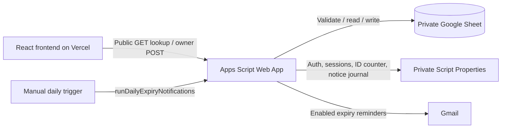

# FitZone Gym Membership Management

FitZone helps a gym owner manage memberships in a private Google Sheet, while
members check their plan and expiry from a simple public page. Each gym gets its
own Sheet, Apps Script project and frontend configuration; this is a one-time
installation model, not a shared subscription platform.

**Production is live:** [fitzone-gym-mu.vercel.app](https://fitzone-gym-mu.vercel.app).
The approved responsive redesign was published from [PR #3](https://github.com/YellankiKaushik/Gym-Membership/pull/3)
at `795153b8614c3dcd867db2cac2b28b63d6afde68`. Subsequent maintenance releases use
the existing Vercel project's automatic `main` deployment.

Start here:

- **New gym:** [installation guide](INSTALLATION.md).
- **New developer:** [current implementation explained](PROJECT_EXPLANATION.md), then
  [developer handoff and documentation index](docs/README.md).
- **Authentication or reminders:** [private owner setup](backend/OWNER_AUTH_SETUP.md)
  and [notification policy](docs/NOTIFICATIONS.md).

## What it does

- Public numeric Member ID lookup with plan, inclusive expiry, status and days left.
- Owner ID/password authentication, memory-only sessions, server-side expiration
  and logout revocation. Reload requires login.
- Add, edit, renew and explicitly confirm deletion; search ID/name/phone, filter,
  paginate and manually refresh Google Sheets data.
- Four plans: **1 Month, 3 Months, 6 Months, 1 Year**. Calendar-safe calculations
  use **Asia/Kolkata**. Expiry day is active; Expiring Soon means **0–7 days**.
- Persistent member IDs are never intentionally reused. Deleted IDs leave gaps.
  Stale row versions protect edits, renewals and deletions.
- Optional expiry emails with locking, a notification journal and a master switch.
- Owner-only WhatsApp links prepare a message; the owner must press Send themselves.
- Responsive light workspace, mobile member cards, accessible labels, keyboard
  dialogs, visible focus and reduced-motion support.

## Stack and architecture

React 19, TypeScript, Vite 7, Tailwind CSS 3 and Lucide React power the frontend.
Google Apps Script V8 implements the API; Google Sheets stores members. Vercel
serves the frontend. There is no local API server, external database or paid
messaging service. Versions are locked in [package-lock.json](package-lock.json).



The frontend calls the configured Apps Script HTTPS `/exec` URL. Public lookup
uses GET; login and owner operations use POST. Apps Script validates input and
sessions, selects the configured workbook/tab, then returns JSON. After a saved
owner operation, the dashboard fetches the latest list. It does not subscribe to
Sheet events or synchronize live across browsers.

## Repository map

```text
src/                       React pages, reusable UI, API client, types and utilities
  assets/gym/              Existing bundled gym photographs
backend/                   Maintained Code.gs, Auth.gs and Bcrypt.gs
  generated/               Ready-to-paste FitZone_Complete.gs
  vendor/                  bcrypt provenance and upstream license
scripts/                   Credential setup, bundle generation and documentation checks
tests/                     Source/bundle regressions and synthetic Chromium workflows
staging/                   Optional disposable-project diagnostics and synthetic rows
docs/                      Current references, historical reports and review screenshots
  assets/, index.html      Preserved legacy GitHub Pages build; not Vercel source
  ui-review/               Synthetic design-review evidence; not application assets
.github/workflows/         Pull-request and main quality checks
README.md                  Start here
PROJECT_EXPLANATION.md     How the current code works
INSTALLATION.md            Separate-gym installation
```

Old Pages assets and reports are intentionally preserved. [The index](docs/README.md)
separates current guidance from historical evidence. Local untracked drafts are
not installation sources. `dist/`, `node_modules/`, `.env.local`, local logs and
test screenshots are ignored by Git. No placeholder public asset is required;
Vite bundles the gym images from `src/assets/gym/`.

## Local development

Use Node.js **24** and npm. Run from the repository root:

```powershell
npm ci
if (-not (Test-Path .env.local)) { Copy-Item .env.example .env.local }
# Set the disposable gym's /exec URL and public branding in .env.local.
npm run dev
```

Open the local URL printed by Vite, normally `http://localhost:5173/`. Preserve
an existing `.env.local`; do not overwrite its endpoint or branding. Restart Vite
after editing it. Real requests need a separately prepared disposable Apps Script
project; browser tests instead use a synthetic endpoint and mocked Google services.
A missing endpoint gives a contact-the-gym error when needed, never an API setup screen.

Every `VITE_*` value is public in the compiled frontend. The build allowlists the
keys in [.env.example](.env.example). Use only the complete Google Apps Script
HTTPS `/macros/s/.../exec` URL, without queries, fragments, surrounding spaces or
`/dev`. Never add owner passwords, hashes, session tokens or private Sheet IDs to
frontend configuration. The local file stays ignored. No deployment URL is stored
in this repository's configuration example.

## Authentication and data rules

Private `OWNER_ID` and cost-12–14 bcrypt `OWNER_PASSWORD_HASH` properties configure
one owner. Generate a verifier with `node scripts/create-owner-config.mjs`; never
commit its output. Login returns a short-lived token, not member data. The API
client keeps the token only in memory. Apps Script stores session records keyed
by token digests, expires them after an absolute 30 minutes, checks credential
rotation and revokes the token at logout. A five-failure/15-minute installation-wide
throttle protects login; it is not a per-IP or public lookup rate limiter.

The Sheet keeps exactly nine columns: **ID, Name, Phone, Age, Weight, Membership
Plan, Start Date, End Date, Notified** (A:I). `SPREADSHEET_ID` and `MEMBER_SHEET_NAME`
select the private workbook/tab. Shared ScriptLock protects API writes; row
fingerprints reject stale saves. Human Sheet edits still require coordination.

Never lower/reset `MEMBER_ID_HIGH_WATER_MARK`. It covers every historically issued
ID, including deleted rows. For this existing disposable installation retain at
least **3**, or any higher historical value. Only a brand-new empty gym starts at 0.
Legacy `001` and numeric `1` match the same canonical ID. Calendar month/year
arithmetic clamps month ends; renewal must start after inclusive current expiry.
Contact-only edits preserve expiry and Notified. See [full membership rules](docs/MEMBERSHIP_CORRECTNESS.md).

## Notifications and WhatsApp

Email is disabled unless `EXPIRY_EMAIL_ENABLED` is exactly `true` and a valid
private `ADMIN_EMAIL` exists. Manually created daily triggers select
**`runDailyExpiryNotifications`**, which calls `checkMembershipExpiries(false)`
without forwarding Google's event object. Installing the code creates no trigger.

The sender shares ScriptLock with CRUD and records per-term `pending`, `sent` or
`failed` journal entries in Script Properties before changing Column I. Sent
records suppress repeats; failed submissions back off for an hour, at most three
attempts while eligible. Ambiguous attempts require checking Sent mail and explicit
reconciliation. Exactly-once delivery is not guaranteed across Google services.

`previewSyntheticExpiryNotifications()` does not access Sheets, properties or
Gmail. `checkMembershipExpiries(true)` previews the configured Sheet without
sending or writing. Follow [the notification guide](docs/NOTIFICATIONS.md).
WhatsApp only builds a validated Indian-mobile `wa.me` link with prepared text;
there is no automatic sender or paid API.

## Tests and maintenance commands

```powershell
npm ci
npm run check:docs
npm run check:backend
npm test
npx playwright install chromium
npm run test:browser
npm run typecheck
npm run lint
npm run build
npm audit
```

`npm test` runs regressions against the three source files and the generated
installer. Browser tests cover synthetic login/session/CRUD, stale edits, summaries,
search/filters, pagination, refresh, all dialogs, keyboard behavior and responsive
widths 320–1920px, landscape and 200% CSS zoom. They block real external requests
except the intercepted synthetic endpoint and never send messages. Counts are
recorded in CI rather than treated as permanent documentation constants.

Edit backend source files, then run `npm run generate:backend` and include the
regenerated installer. `npm run build` also regenerates it; `check:backend` rejects
a stale artifact. Never paste the installer alongside the originals. Preserve the
[bcrypt license and integrity checks](backend/vendor/README.md).

## Vercel deployment flow

The existing **fitzone-gym** project is linked to this GitHub repository with
production branch **main**, Vite at repository root, Node 24 and output `dist`.
Vercel runs the project's existing build settings; `npm run build` is the build
command. Use `npm ci` for repeatable local/CI installs.

1. Make a focused branch/PR and pass all checks. Branch previews use Vercel's
   existing preview environment; a preview is not a production release.
2. Merge the approved PR. The existing Git integration automatically builds main
   using its production environment variables, including `VITE_APPS_SCRIPT_URL`.
3. Confirm the deployment is Ready, its commit is correct and the existing domain
   points to it; smoke-test the public UI. Do not print endpoint/credential values.

Frontend publication does **not** install Apps Script changes. Backend updates
remain separate, deliberately authorized Google-project operations. Do not change
existing production environment settings, deploy a disconnected local copy or
create a replacement project during routine maintenance.

`npm run deploy` is a retained **legacy GitHub Pages** command, not Vercel.
`gh-pages` and the legacy docs build are retained because their usage cannot be
established conclusively. Do not run that command as part of a Vercel release.

## Evidence, limitations and readiness

- **Verified release evidence:** PR #3 was merged; Vercel served the approved UI;
  production lookup/login presentation passed at eight widths and a read-only
  unknown ID reached Apps Script. No browser console/resource errors were recorded.
- **Owner-reported manual evidence:** the owner reports manual application testing
  and a successful real Gmail test. This is not a claim that this maintenance
  session repeated authenticated production or email tests.
- **Automated evidence:** source/bundle and mocked-browser tests cover auth,
  sessions, CRUD, calendar rules, notification safety and UI behavior. They do not
  certify Google quotas, real concurrency, delivery or physical mobile keyboards.
- **Public privacy limit:** numeric IDs are enumerable. Lookup returns only ID,
  pseudonym, plan, inclusive expiry, status and days remaining, but those details
  can still be discovered without member authentication. No public rate limiter
  or identity verification is implemented. Review this before a sensitive rollout.
- **Commercial checks:** each gym still needs private configuration/backups,
  access and data-retention review, real Google permission/quota/session testing,
  scheduler/delivery monitoring, physical-device/browser acceptance and recovery
  rehearsals. This is not a payment ledger, attendance tracker or term history.
- **Dependency audit:** nine development-tool advisories remain (7 high, 2 moderate);
  compatible audit dry run offers no fix. Runtime-only audit is clean at this audit.
  See [maintenance findings](docs/README.md#maintenance-findings-16-october-2026).

No Firebase, Supabase, payments, automatic WhatsApp, AI predictions or subscription
billing is implemented or promised. The original aspirational narrative remains
available in Git history; the current explanation describes only shipped behavior.
