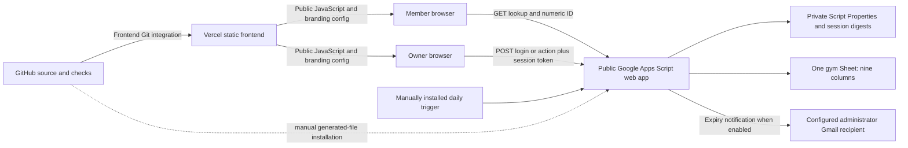

# FitZone security audit report

Audit date: **19 October 2026**. Repository: `YellankiKaushik/Gym-Membership`. Branch: `main`. Source baseline: `89472587fa592ad96aaecd8807366d5f65ddea60`.

**Phase 1: audit only.** This report and [the remediation plan](SECURITY_REMEDIATION_PLAN.md) are the only requested file changes. No remediation is implemented or authorized by this document.

## Executive security assessment

**Overall risk: High; overall confidence: moderate.** Source review, isolated tests and accessible hosting/repository metadata provide strong evidence for the observations below. Production Google permissions, deployed backend equivalence, recovery arrangements and actual abuse thresholds remain unverified. The rating reflects the combined impact of privileged account compromise, weak release gates and destructive operations without an application recovery layer; it does not mean an anonymous attacker was shown to obtain owner access.

**No authentication bypass, complete anonymous member-database disclosure, live account compromise or cross-gym session acceptance was demonstrated.** The current public lookup deliberately hides names and contact information. Its remaining membership facts are enumerable, however. Existing authentication, validation, concurrency and notification safeguards are substantial and should be preserved.

There are **11 confirmed findings/risks: 0 Critical, 3 High, 7 Medium, 1 Low**. These include architectural and operational risks, not eleven proven exploitable code defects. Severity describes business risk under each finding's stated preconditions. Confidence **Confirmed** means the stated implementation/configuration was observed; it does not confirm a hypothetical production attack or an unknown external control. Unverified environment items and optional defensive improvements are listed separately and excluded from these counts.

| Urgency | ID | Severity | Class | Confirmed observation |
| --- | --- | --- | --- | --- |
| 1 | F04 | High | C: operational | `main` has neither branch protection nor repository rulesets enforcing review/checks |
| 2 | F05 | High | B: architectural | Deletion physically removes rows; renewals replace the current term; application recovery/history layer absent |
| 3 | F06 | High | B: architectural | One password authenticates the owner with all member privileges; no application MFA or destructive-action step-up |
| 4 | F01 | Medium | B: architectural | Anonymous numeric-ID lookup discloses membership facts |
| 5 | F02 | Medium | A: source defect | Five anonymous malformed login failures block the owner's correct login |
| 6 | F03 | Medium | B: architectural | Public lookup reads/scans the entire Sheet without an application abuse budget |
| 7 | F07 | Medium | C: hosting | Public application can be framed; CSP and several browser headers absent |
| 8 | F08 | Medium | B: architectural | Application security events and attributable CRUD audit records absent |
| 9 | F10 | Medium | C: operational | One backend-URL environment binding targets both preview and production |
| 10 | F09 | Medium | C: supply chain | Nine affected development-package entries from two dependency advisories |
| 11 | F11 | Low | C: history | Historical commits contain Google deployment/Sheet identifiers, not authentication secrets |

No CVSS 4.0 scores are assigned: exploitability and deployment prerequisites are insufficiently established for meaningful numeric vectors. Upstream dependency scores below are explicitly CVSS **3.1**, not audit CVSS 4.0 scores.

## Scope, method and execution boundaries

Inspected the tracked application, backend sources and generated bundle, vendored bcrypt and license, package manifests/lockfile, configuration and HTML/CSS, scripts, staging helpers, unit/integration/browser tests, GitHub workflow and installation/notification/release/security-related documentation. A targeted AST check parsed all **17** frontend TypeScript/TSX files. Reviewed the legacy `docs/` static site as a historical artifact rather than treating it as current Vercel source. Reviewed available local Git history without fetching or rewriting it.

Live inspection was limited to authenticated **read-only metadata** for GitHub/Vercel, public frontend HTML/JavaScript responses, response headers and a passive framing check. No real backend login, member lookup, mutation, email, WhatsApp send, trigger execution, load test or Google deployment was performed. All behavioral probes used synthetic records, synthetic credentials and in-memory Google-service doubles. Existing browser tests intercept backend requests; they do not attest to live Google behavior.

No application source, dependency versions, environment files, Google settings, Vercel settings or GitHub settings were changed. No commit, push, branch, deployment or trigger was created. Existing unrelated untracked files were left untouched. Private deployment URLs, Sheet IDs, account/project identifiers and credential values are intentionally omitted. `.env.local` was not opened or modified for this audit.

## Architecture and trust boundaries

### Actual installation model

Each gym uses a **separate frontend installation, Apps Script project and Google Sheet**. There is no central tenant registry, tenant claim or database row-level tenant policy. Isolation comes from distinct deployments, Script Properties, session stores, credentials and Google permissions. Reusing an owner password between installations is possible operationally; it is not prevented by the application.

Vercel serves static frontend assets; it is **not presently a trusted API gateway**. Browsers call Apps Script directly. Anyone who discovers the endpoint may call it independently of the UI. Google Apps Script authorization therefore matters on every protected dispatch. Vercel deployments do **not** publish Apps Script source or change the Sheet.

### Assets, data and secrets

| Asset | Location and flow | Boundary / consequence |
| --- | --- | --- |
| Member identity/contact and physical attributes | Sheet columns A:I: ID, Name, Phone, Age, Weight, Membership Type, Start Date, End Date, Notified | Full records only through owner-authorized `getAll`; Google editors bypass application controls |
| Membership facts | Public lookup DTO: ID, pseudonymous label, plan, expiry, status, nonnegative remaining days | No owner authentication; numeric IDs are discoverable |
| Owner password verifier and configuration | Script Properties: owner ID, bcrypt verifier, Sheet/tab, administrator email, switches and counters | Google project editors must be trusted; frontend must never receive verifier/password configuration |
| Raw session token | Returned once at login; module memory in the browser; POST body on protected calls | Bearer credential usable until expiry/revocation if stolen |
| Session records | Script Properties keyed by SHA-256 of token; expiry and credential version | Independent per project; rotation invalidates earlier credential-version sessions |
| Notification journal | Per-member/term states in Script Properties; Column I on Sheet | Needed for deduplication and safe restore, not an access-security audit log |
| Member name, phone, ID and expiry in email | Backend to configured administrator Gmail mailbox | Additional personal-data copy, retention and mailbox permissions matter |
| Public build settings | `VITE_*`, selected `__GYM_PUBLIC_CONFIG__`, compiled assets | Public by design; endpoint URL is routing information, not an authentication secret |
| Source and release authority | GitHub writers/workflows; Vercel project; Google project editors | A compromised trusted publisher can replace login code or backend authorization |

### Every application communication path

| Path | Request / authority | Behavior and evidence |
| --- | --- | --- |
| Public lookup | `GET action=lookup&id=...` | `src/api/gymApi.ts:143–153` to `backend/Code.gs:41–67,216–232`; no identity/contact fields in DTO |
| Owner login | `POST {action:login, ownerId, password}` | `gymApi.ts:100–133`; `Code.gs:84`; `Auth.gs:44–96`; login response contains session, not member records |
| Owner data listing | POST `getAll` plus session | `gymApi.ts:159–169`; `Code.gs:85–96,234–244` |
| Add, edit, renew, delete | POST corresponding action plus session | `Code.gs:98–112`; bounded/validated input and write lock; see data-integrity assessment |
| Logout | POST `logout` plus session | `gymApi.ts:136–140` clears browser state immediately; `Code.gs:87–89` deletes server session |
| Automated email | Google time-driven event to parameterless `runDailyExpiryNotifications` | `Code.gs:416–418`; normal sender called with `false`; not exposed in HTTP action switch |
| Preview/reconciliation | Editor-only functions | Synthetic preview does not use Google services; configured-Sheet dry run reads only; explicit reconciliation is privileged and not an HTTP operation |
| WhatsApp | Owner manually opens encoded `wa.me` link | Validated phone, encoded message, `noopener,noreferrer`; no automatic send or WhatsApp API secret |
| Branding and maps | Trusted build-configured image URLs/map link | External image requests may disclose visitor network metadata; external map links use opener/referrer protections |

Requests use HTTPS, text/plain JSON POSTs (Google compatibility), redirects and a 20-second abort including response consumption. Reads and logout may retry up to three attempts; member mutations are not blindly retried. App responses carry JSON success/code semantics; a Google HTTP 200 alone is not proof a protected operation succeeded.

### Authentication and authorization assessment

- **Password storage:** vendored bcryptjs 3.0.3; private provisioning tool generates cost 12 using Node WebCrypto; backend only accepts configured costs 12–14. No plaintext password is stored by the application. Minimum 12 characters; inputs that exceed bcrypt's 72 UTF-8-byte limit are rejected instead of silently truncated. No common/breached-password check or MFA exists. No actual production password strength was tested.
- **Comparison and throttling:** valid-shaped passwords are compared even for a wrong owner ID; failed credentials have the same error. ScriptLock serializes login and bounds concurrent session creation. Global five-failure lockout creates F02; production timing side channels and bcrypt execution duration remain unmeasured.
- **Session creation:** two platform UUIDs form a 64-hex-character bearer token (`Auth.gs:86–92`). Generation relies on Google's UUID randomness, not an application Math.random fallback. Exact production entropy was not measured. Only token digests are stored server-side. Twenty active sessions maximum; oldest evicted at the limit.
- **Expiration/revocation:** server absolute lifetime 30 minutes; invalid, expired or credential-version-mismatched records rejected (`Auth.gs:99–109`). Password/owner-ID configuration rotation invalidates old credential-version sessions. Logout deletes the current server record. Browser state is memory-only, endpoint-bound and cleared on logout/expiry; legacy stored secrets are erased. Browser idle timeout is additional UX protection, not server enforcement.
- **Authorization:** `Code.gs:85–86` validates the session before every non-login POST action, including reads, writes and logout. GET permits lookup only. Guessing an action name or directly calling Apps Script does not bypass that gate. No public email/delete/configuration action was found. One authenticated owner has all privileges; no staff roles or per-action step-up exists.
- **Replay/fixation:** new logins create fresh tokens; no client-selected session ID. Stolen raw tokens remain replayable during their lifetime. Logout cannot retract a request already authorized and executing; network-failed logout clears the browser but cannot guarantee immediate server revocation. No demonstrated session fixation bug.
- **Cross-gym check:** a token minted in one isolated synthetic Script Properties store was rejected by a second store, for both source and bundled backend. This supports project isolation, not verification of actual Google project separation.

### Threat model

| Actor | Feasible entry / prerequisites | Impact and current boundary |
| --- | --- | --- |
| Anonymous internet user | Direct public Apps Script GET/login | Enumerate membership facts, consume read/compute quota, trigger global lockout; protected CRUD still requires token |
| Malicious member | Own/guessed numeric IDs; possible knowledge linking an ID to a person | Infer others' membership facts; no identity fields returned by current DTO |
| Leaked-password attacker | Valid owner ID/password | Obtain session, list full member data, edit/renew/delete; MFA absent |
| Stolen-token attacker | Token from browser compromise/phishing/malicious publisher | Same owner privileges until expiry/revocation; no token-to-device binding or step-up |
| Compromised browser | Malicious extension, local malware or future origin script compromise | Read active token/member data or invoke operations; memory-only storage reduces persistence, not this threat |
| Dependency/release attacker | Compromised dependency, GitHub writer or publisher | Replace served login code, tamper build; pinned actions and lockfile help, unprotected main weakens gate |
| Unauthorized Google collaborator | Google project/Sheet editor access or compromised execution account | Read/modify Sheet or Script Properties and code, bypass app authentication entirely |
| Malicious staff/internal user | Shared owner credentials or direct Sheet access | Full privileges and poor attribution; no staff-level roles; application locks do not govern manual Sheets edits |

Single points of failure include the Google execution account, each Sheet and Script Properties store, owner credential/recovery process, frontend publisher and unverified backup operator. An account with access to many gyms increases blast radius despite separate deployment URLs.

## Detailed findings

Classes: **A** confirmed source-code defect; **B** architectural risk; **C** operational/configuration risk. Items in **D** require environment verification and **E** are defensive improvements. Framework labels indicate relevant controls, not certification results.

### F01 — Predictable public IDs expose membership facts

- **Severity / confidence / class:** Medium / Confirmed / B.
- **Location and evidence:** [Code.gs](../backend/Code.gs#L216), lines 41–50 and 216–232. Lookup requires only a positive numeric ID; lines 227–228 return membership type, end date, status and remaining days. Isolated ID `1` lookup confirmed those fields and the pseudonymous `Member #1` label in source and bundle.
- **Weakness / mapping:** CWE-359 where membership information is intended to be private; OWASP A01/A06; ASVS V8 authorization and V14 data protection; CIS Controls 3 and 6. This is an intentional public contract with residual privacy risk, not an owner-authentication bypass.
- **Scenario / conditions:** an unauthenticated caller walks numeric IDs and distinguishes existing members. Linking a known ID to a person reveals that person's membership facts. Endpoint knowledge is sufficient; no password required.
- **Impact / limits:** membership profiling and existence disclosure; current response does **not** expose actual name, phone, age, weight, password or all owner data. Sensitivity depends on the gym's privacy commitments and ability to link IDs to people. No production enumeration was conducted.
- **Remediation:** approve an explicit privacy policy. Prefer owner-only access or a separate high-entropy member-bound lookup capability with minimal output, revocation and abuse controls. Merely renumbering IDs, hiding the URL or asking for an easily guessed name/phone suffix is insufficient.
- **Regression / breakage / deployment:** test guessed/invalid/revoked capabilities, uniform failures and allowlisted DTOs in source/bundle/browser. This changes existing numeric lookup UX and printed/member instructions. Requires approved member-access migration, manual Apps Script deployment and frontend/Vercel deployment; keep column A's persistent internal ID and nine-column structure.

### F02 — Global throttle enables anonymous owner-login lockout

- **Severity / confidence / class:** Medium / Confirmed / A.
- **Location and evidence:** [Auth.gs](../backend/Auth.gs#L44), lines 51–68 and constants 4–8. One project-wide failure record counts even malformed credentials. Isolated probe: five `ownerId:'unknown', password:null` failures returned `INVALID_CREDENTIALS`; the next correct login returned `RATE_LIMITED`, with zero Sheet writes, in source and bundle.
- **Weakness / mapping:** CWE-645 overly restrictive account lockout; OWASP A07/A06; ASVS 6.1.1 and 6.3.1; CIS 6/16.
- **Scenario / conditions:** any anonymous caller can spend five requests to prevent new owner logins for the remainder of the 15-minute failure window, then repeat after it expires. No knowledge of the actual owner ID or password is necessary.
- **Impact / limits:** operational availability and owner support burden. Existing valid sessions remain usable. No real endpoint was attacked, and no credential guessing resistance should be removed in response.
- **Remediation:** design bounded anti-automation and progressive throttling that does not let unauthenticated malformed traffic monopolize a shared owner lockout budget. Reliable edge identity/challenges may help, but GAS does not provide a trustworthy client-controlled IP header. Preserve bounded bcrypt work and session/write locks.
- **Regression / breakage / deployment:** synthetic event/input permutations, valid-owner availability after hostile invalid traffic, parallel attempts and brute-force budget tests. Changes login failure behavior; requires careful staging quota measurement. Backend change plus bundle regeneration/manual Google deployment; Vercel only if challenge/auth UX changes.

### F03 — Public lookups perform unbounded full-Sheet work

- **Severity / confidence / class:** Medium / Confirmed / B.
- **Location and evidence:** [Code.gs](../backend/Code.gs#L162), lines 162–174 and 216–224. `getDataRange().getValues()` reads all rows and duplicate-validates IDs before searching. The isolated single-member lookup recorded a full-range read. No application request budget or public-lookup rate limiter exists.
- **Weakness / mapping:** CWE-400 / CWE-770; OWASP A06/A10; ASVS V4 API security and V13 configuration; CIS 4/16.
- **Scenario / conditions:** direct unauthenticated lookup traffic repeatedly consumes Google execution/read resources as the Sheet grows; contention/quota exhaustion can affect legitimate users and scheduled work. Invalid IDs rejected before the read are cheaper, so abuse needs valid-shaped IDs.
- **Impact / limits:** availability/cost/support risk; actual failure rate, Google limits and dataset size were **not load-tested**. Provider protections may help but do not make the per-request full scan disappear.
- **Remediation:** minimize public capability access, bound request/work budgets, measure safe indexing/cache design and invalidate on writes. Any gateway must be backed by direct GAS verification so bypassing Vercel cannot bypass controls. Google account/project quotas need an inventory before selecting limits; see [Google quotas](https://developers.google.com/apps-script/guides/services/quotas).
- **Regression / breakage / deployment:** isolated large synthetic datasets, stale cache/duplicate-ID handling and approved disposable-staging concurrency tests with stop budgets. Preserve immediate correctness and nine columns. Backend changes/manual Google deployment; Vercel deployment only if introducing gateway/client changes.

### F04 — Main branch does not enforce review or checks

- **Severity / confidence / class:** High / Confirmed / C.
- **Location and evidence:** live GitHub branch metadata on audit date: `protected:false`, required-check enforcement off with no required contexts; repository rulesets returned `[]`. Cloud setting has **no source line**. Related [workflow](../.github/workflows/authentication-checks.yml#L3), lines 3–9 and 20–37, runs checks but does not enforce merging policy. Live Vercel metadata identifies `main` as production branch.
- **Weakness / mapping:** CWE-693 broadly applicable protection gap; OWASP A02/A03/A08; ASVS V13 configuration; CIS 4/6/16.
- **Scenario / conditions:** a compromised or careless repository writer can push directly to main without an enforced independent review/green checks. The production Git integration can publish frontend changes; exact deployment-check timing was not verified. An anonymous GitHub reader cannot write merely because the repository is public.
- **Impact / limits:** malicious login UI, credential theft, source integrity loss or outage. A frontend merge does not automatically deploy GAS, but it can change what owners execute in the browser.
- **Remediation:** configure a main ruleset with pull requests, suitable review ownership, required current CI checks, force-push/deletion restrictions and controlled bypass. Account for the sole maintainer's ability to approve/release without creating a lockout. Require strong GitHub/Vercel account authentication and review app permissions.
- **Regression / breakage / deployment:** verify disposable PR cannot merge when checks fail, direct push/force push is denied to intended actors and documented emergency recovery works. Changes release process, not application runtime. GitHub/Vercel account settings only; no GAS or frontend deployment intrinsically required.

### F05 — Destructive data lifecycle lacks an application recovery layer

- **Severity / confidence / class:** High / Confirmed / B.
- **Location and evidence:** [Code.gs](../backend/Code.gs#L350), lines 350–361 physically delete rows; lines 327–344 replace the current membership term. No soft-delete/archive, independent backup scheduler or tested restoration implementation is present in the repository. **External backups and Google version-history recoverability are NOT VERIFIED**, so this is not a claim that all backups are absent.
- **Weakness / mapping:** no narrow CWE asserted for a business recovery design; OWASP A06/A08; ASVS V14 data protection; CIS 3/11/17.
- **Scenario / conditions:** a stolen valid owner session or an operator mistake deletes/overwrites paid-membership records. A Google account attacker may also damage Sheet history and same-account copies. A common-identity backup may fail along with the primary account.
- **Impact / limits:** business interruption, lost paid-term history, disputed entitlements and ransomware-style destruction **if independent recoverable backups are unavailable**. No production row was modified. Existing locks/version checks prevent some conflicts, not deliberate authorized deletion or disaster.
- **Remediation:** independently permissioned encrypted snapshots, tested restore and explicit RPO/RTO; reversible deletion/history outside the nine live columns. Back up persistent ID high-water mark and notification state safely; do not restore active sessions. Keep ownership and retention requirements explicit.
- **Regression / breakage / deployment:** synthetic delete/renew recovery, restore counters/no ID reuse, expiry dates/notification journal and schema validation; compromise of primary identity must not erase retained backups. Retention affects privacy obligations and deletion UX. Backup infrastructure may be separate; soft deletion/history needs backend deployment and likely frontend changes; schema/migration approval required before implementation.

### F06 — Password-only owner access grants the entire administrative capability

- **Severity / confidence / class:** High / Confirmed / B.
- **Location and evidence:** [Auth.gs](../backend/Auth.gs#L59), lines 59–93, accepts one ID/password factor and issues a full owner session; [Code.gs](../backend/Code.gs#L84), lines 84–112 and 234–244, allows full listing and all mutations to that session. No second factor, separate staff principal, destructive-action reauthentication or member-scoped owner role was found.
- **Weakness / mapping:** CWE-308 for missing additional authentication factor; OWASP A07/A06; ASVS 6.3.3 (Level 2 MFA objective), V8 authorization; CIS 5/6. Absence of staff roles in a single-owner product is a scope limitation, not a demonstrated privilege-escalation bug.
- **Scenario / conditions:** phished, reused or otherwise stolen valid owner credentials permit full data disclosure/modification/deletion. A stolen active session also retains all privileges without destructive-operation step-up. No weak actual password, theft or successful attack was demonstrated.
- **Impact / limits:** full per-installation compromise. Good bcrypt, short sessions and private configuration mitigate different threats but do not stop use of valid stolen credentials. Google-account MFA protects Google administration, not this custom web login.
- **Remediation:** choose managed phishing-resistant owner authentication/MFA with server-side assertion validation and recovery, or a carefully reviewed factor lifecycle. Bind verified identity to the correct installation; add fresh authentication for export/destruction. Introduce individual staff roles only when needed, never shared-owner credentials as staff management.
- **Regression / breakage / deployment:** factor enrollment, recovery, replay, expired challenge, issuer/audience/installation checks, revocation and negative tests on every action. Must preserve a tested operator recovery path; this materially changes login. Manual GAS and frontend deployments, private provider configuration and credential migration are required if adopted.

### F07 — Framing allowed and browser hardening headers incomplete

- **Severity / confidence / class:** Medium / Confirmed / C.
- **Location and evidence:** live public HTML/asset responses on audit date; no source line exists for observed hosting headers. Related [index.html](../index.html#L1), lines 1–22, has meta `no-referrer`; [vite.config.ts](../vite.config.ts#L10), lines 10–22, defines no hosting header policy; no tracked Vercel header configuration exists. HTML returned HTTP 200, HSTS `max-age=63072000; includeSubDomains; preload`; CSP, CSP-Report-Only, X-Frame-Options, X-Content-Type-Options, HTTP Referrer-Policy, Permissions-Policy and COOP were absent. A passive iframe rendered the Member Lookup heading from an unrelated top-level document; backend requests and non-GET/HEAD requests were blocked in that check.
- **Weakness / mapping:** CWE-1021 for UI framing; OWASP A02; ASVS V3 browser security; CIS 4/16. Missing CSP is defense-in-depth, **not evidence of existing XSS**.
- **Scenario / conditions:** an attacker-controlled page frames the app and tricks an interacting owner into UI actions, potentially after login. No owner login or harmful click was attempted; parent code still cannot read the frame's token across origins.
- **Impact / limits:** UI-redress risk; weaker containment if a future injection appears. HSTS and existing meta referrer protection are credited. Public static HTML's `Access-Control-Allow-Origin:*` does not disclose owner records by itself.
- **Remediation:** response `frame-ancestors 'none'` and X-Frame-Options DENY, nosniff, explicit no-referrer and minimal Permissions-Policy. Roll out a compatible CSP in Report-Only before enforcement; proposed policy and origin dependencies are in the plan. Do not blindly add a policy that breaks branding, Google redirects or future login providers.
- **Regression / breakage / deployment:** browser header/framing tests and lookup/login/CRUD/branding/WhatsApp regression. Framing integrations will stop working intentionally; inline style and provider-origin behavior must be checked. Requires Vercel configuration/frontend deployment only; no GAS change intrinsically required.

### F08 — Security operations are not durably attributable or monitored in the application

- **Severity / confidence / class:** Medium / Confirmed / B.
- **Location and evidence:** [Auth.gs](../backend/Auth.gs#L64), lines 64–92; [Code.gs](../backend/Code.gs#L72), lines 72–133 and 303–365, return outcomes without emitting structured login/session/CRUD security events or actor-linked audit records. Notification term journal at lines 437–458 serves delivery deduplication, not access auditing.
- **Weakness / mapping:** CWE-778; OWASP A09; ASVS V16 logging/error handling; CIS 8/17.
- **Scenario / conditions:** credential abuse or insider deletion resembles ordinary owner work and leaves no application event history sufficient to attribute the action or alert on unusual destructive activity. Requires malicious use or an incident; not a new route to bypass authorization.
- **Impact / limits:** delayed detection, limited investigation and recovery confidence. Google execution/audit logs may exist; their contents, retention and alerting are **NOT VERIFIED**. Generic client errors appropriately avoid exposing exception details.
- **Remediation:** privacy-minimal security events in a separately protected sink, defined retention and alerts for authentication anomalies, credential changes and destructive-operation spikes; installation/principal/action/result/correlation/time, not passwords, tokens or member contact values.
- **Regression / breakage / deployment:** assert event completeness/redaction, access control, tamper resistance and safe failure under a logging outage. Logging should not leak data or silently disable authorization. Backend/manual Google deployment and logging configuration required; Vercel deployment only for gateway/frontend telemetry if separately approved.

### F09 — Development dependency advisories affect build tooling

- **Severity / confidence / class:** Medium application-context risk / Confirmed / C. Upstream package-entry severity totals are **7 High + 2 Moderate**, not nine independent exploit chains.
- **Location and evidence:** [package-lock.json](../package-lock.json#L2038): `braces` 3.0.3 at lines 2038–2039; `postcss-selector-parser` 6.1.4 at 3796–3797. Parent tooling includes gh-pages at 2835, postcss-nested at 3770 and Tailwind at 4181. `npm audit --json` exited 1 with nine affected entries; `npm audit --omit=dev --json` exited 0 with zero runtime entries.
- **Weakness / mapping:** CWE-674 / CWE-400 / CWE-407; OWASP A03; ASVS V13; CIS 2/7/16. Advisory [GHSA-vfj7-8cjw-p6xm](https://github.com/advisories/GHSA-vfj7-8cjw-p6xm) concerns recursive pattern stack exhaustion (upstream CVSS 3.1: 7.5); [GHSA-rj75-hqrm-r3gf](https://github.com/advisories/GHSA-rj75-hqrm-r3gf) concerns selector-parser CPU exhaustion (upstream CVSS 3.1: 5.9).
- **Scenario / conditions:** crafted patterns/selectors reach vulnerable build/publish tooling. Trusted repository-controlled build inputs narrow exposure; no anonymous production route accepting such inputs into those packages was found. Advisory presence does not demonstrate browser remote-code execution.
- **Impact / limits:** developer/CI availability and supply-chain maintenance risk. npm audit does not cover the vendored bcrypt source or all malicious-package behavior. No package fixes were applied.
- **Remediation:** evaluate tested dependency-chain updates or supported replacements, preserving Tailwind output and current release behavior. Do not automatically run `npm audit fix --force`: suggested changes include a major Tailwind migration and a gh-pages version change that require compatibility review. Add monitored dependency updates and explicit exception ownership.
- **Regression / breakage / deployment:** clean locked install, advisory recheck, complete tests and visual build comparison in an approved branch/phase. CSS/toolchain migration may change UI; lockfile/source updates and frontend deployment needed when shipped. GAS deployment only if backend source also changes, not for dependency-only CSS fixes.

### F10 — Preview and production share the backend environment binding

- **Severity / confidence / class:** Medium / Confirmed / C.
- **Location and evidence:** sanitized live Vercel environment metadata showed one sensitive-type `VITE_APPS_SCRIPT_URL` entry targeted to both `production` and `preview`, with no branch scope. **Values were not retrieved for this review.** Related build consumption: [vite.config.ts](../vite.config.ts#L5), lines 5–20; credential submission [gymApi.ts](../src/api/gymApi.ts#L111), lines 111–130. No source line exists for the cloud binding. No preview bundle was authenticated or exercised, so actual preview endpoint selection under other overrides is not proven.
- **Weakness / mapping:** OWASP A02/A06; ASVS V13/V14; CIS 3/4/6/16; no narrow CWE asserted. A frontend endpoint is public even when its Vercel environment entry has type `sensitive`.
- **Scenario / conditions:** an owner signs into a preview containing untrusted changed code using production credentials, or tests writes against a backend inherited from the production binding. A compromised preview can capture credentials before any backend checks. Vercel SSO protection is configured, but authorized review access does not make the changed code trustworthy.
- **Impact / limits:** avoidable production credential/data exposure or accidental writes. No actual preview compromise, production mutation or confidential Vercel environment secret was found.
- **Remediation:** distinct synthetic staging project/Sheet/owner credentials for previews, explicit environment targets and acceptance checks. Never instruct reviewers to enter production credentials into an untrusted preview. Continue treating build-time variables as public.
- **Regression / breakage / deployment:** assert endpoint destination in production versus preview builds without printing values; confirm synthetic-only Sheet and mismatched-session rejection. Requires environment setting approval and rebuilding affected previews; production redeployment only if its binding changes. A disposable Google project/deployment may be needed; do not alter the current backend during audit.

### F11 — Historical Google identifiers remain discoverable

- **Severity / confidence / class:** Low / Confirmed / C.
- **Location and evidence:** local reachable Git object scan found historical Apps Script URLs in `gym api apps script.txt:3` and several earlier `src/api/gymApi.ts` blobs (lines 15/16/19). Historical `gym member ship.txt` blob `9584f7a0bc194a00ab513e874e064d97c8f6e16e` contains a Sheet URL at line 3 and Apps Script references at 22/24/29. Values are intentionally omitted; this does not refer to reading or altering today's unrelated untracked files.
- **Weakness / mapping:** limited information exposure (CWE-200 only as metadata classification); OWASP A02; ASVS V13/V14; CIS 3/4. URLs/IDs are **not authentication credentials** and are not themselves proof a Sheet is public.
- **Scenario / conditions:** repository readers discover historical services; harm requires an old endpoint to remain accessible/insecure or permissive Google sharing. Neither condition was tested. Current tracked-text targeted patterns found no corresponding literal endpoint/credential matches.
- **Impact / limits:** endpoint inventory and privacy-hygiene risk, not demonstrated unauthorized Sheet access or a password leak. Scanner scope was 38 locally reachable commits/198 text blobs, not every server object or deleted remote ref.
- **Remediation:** privately inventory identifiers and owners, verify ACLs, retire unused deployments after dependency checks and address any actual secret exposure if discovered. Do not rely on URL secrecy or rewrite history/rotate harmless public endpoint URLs as a substitute for authorization.
- **Regression / breakage / deployment:** owner-reviewed historical service inventory and safe access-policy checks. Retiring a still-used endpoint can break installed clients/triggers. No frontend/GAS deployment inherently needed for inventory; retire/reconfigure only with explicit later approval.

## Data protection, integrity and recovery assessment

### Controls working in the reviewed implementation

| Area | Evidence and practical limit |
| --- | --- |
| Public minimization | Explicit DTO at `Code.gs:225–228`; identity/contact attributes withheld; remaining facts still create F01 |
| Server access gate | `Code.gs:84–112`; all privileged actions require server-validated session, independently of frontend buttons |
| Safe member input | `Code.gs:246–265`; bounded names, formula-leading/control characters rejected; phone/age/weight/date/plan checks; IDs must be positive safe integers |
| Spreadsheet injection | Name rejects leading formula operators after trimming; phone is validated and stored in text-formatted cells; dates and numeric fields constrained. No formula injection demonstrated; manual Sheet edits bypass validation |
| Nine-column model | CRUD preserves A:I layout, no hidden credential columns. Four plan/date rules shared in regression tests |
| Concurrent writes | ScriptLock plus flush/finally; duplicate canonical IDs fail closed. Direct human Sheet edits and other script projects are outside that lock |
| Persistent IDs | High-water mark reserved before row write/deletion; failures may create harmless gaps but should not reuse old IDs |
| Conflict detection | Expected-version comparison rejects stale current-client writes; omission remains compatibility-permitted, see E01 |
| Renewal/edit integrity | Inclusive expiry overlap rejected; contact-only edit preserves term/notification state; history still overwritten on renewal |
| Private config/error handling | Explicit private Sheet ID/tab; generic exceptions, no raw Google IDs in API failures; malformed/missing config fails closed |
| Session confidentiality | Memory-only browser token, server digest, POST bodies, endpoint binding, HTTPS destination validation and legacy storage cleanup |
| Notification safeguards | Disabled unless exact `true`; per-term pending/sent/failed journal, one-hour backoff/max three eligible failures, legacy Notified support, shared lock; ambiguous delivery needs explicit reconciliation |
| Preview/trigger isolation | Pure synthetic preview has no Google-service calls; Boolean-only normal function; parameterless trigger wrapper safely ignores Google event argument |
| Source/bundle integrity | Fixed Bcrypt/Auth/Code generation order, duplicate-global checks, parse and freshness checks; source/bundle behavior tested |
| CI hygiene | Read-only contents permission, actions pinned to full SHAs, persisted checkout credentials disabled, locked install and regression/browser jobs; F04 still prevents enforcement claims |

The bcrypt vendor payload is pinned to SHA-256 `ed01b52b436504d8bb7086d93fee4bd8edbb22d8ed88e1b456e0c604f30e79c4`. Integrity and passing synchronous-compatibility tests are useful; they do not prove absence of all cryptographic vulnerabilities or live Google runtime equivalence. Generated-file installation must use **either** the single bundle **or** the three sources, not both. Staging helper guards are not included in the production installer.

### Recovery readiness

Physical deletion, overwrite of current terms, optional conflict versions, manual Google edits and independent Google/Vercel releases form separate loss modes. A frontend rollback cannot restore Sheet rows, Script Properties or a previous Google web-app version. A GAS rollback must select/redeploy a known version and account for data/schema/state compatibility; do not blindly revert authentication to an older insecure version.

No measured RPO, RTO, independent backup identity, retention policy or successful restore evidence was available. Sheet version history may assist accidental edits but must not be assumed to survive primary-account compromise or meet recovery targets. Member data in email and backups needs access limits and a lawful retention/deletion policy; legal jurisdiction/compliance was not assessed.

Proposed targets for owner approval, **not achieved guarantees**: RPO 24 hours; RTO four hours; daily snapshots retained 30 days, weekly 12 weeks, monthly 12 months, adjusted for privacy obligations/cost. Restore must preserve A:I types/dates, ID high-water mark and notification journal/Notified consistency. Exclude `OWNER_SESSION_*` records so recovery cannot revive stolen sessions. Recover private configuration/verifiers only through a separate encrypted secret-recovery procedure, with deliberate credential rotation as appropriate. Use a separate backup identity that the running application cannot use to delete historical copies.

## Multi-gym isolation and scaling

An installation-specific session does not authenticate at another independent project in isolated tests. A frontend configured to another endpoint will show that installation's public facts and submit credentials there; a trusted Google-domain URL is not proof it belongs to the right gym. Compiled configuration takes precedence over legacy localStorage. If owners reuse credentials across deployments, the app cannot prevent someone from logging into both. A mistaken `SPREADSHEET_ID` or broad execution-account permission can point a project at a different accessible gym Sheet. No live installation inventory was available to prove those separations.

| Scale | Continue isolated installations | Conditions that justify evaluating a central service |
| --- | --- | --- |
| 10 gyms | Practical with unique owner identities, least-privilege Google accounts, release/config inventory, staged updates and independent backups | Specific need for staff roles, stronger auth or centralized audit; address those directly first |
| 100 gyms | Drift, credential lifecycle, manual deployments, backup verification and support become operational work; account-scoped quota/blast radius needs measurement | Measured deployment effort, service incidents or reporting needs exceed a managed-installation approach |
| 1,000 gyms | No demonstrated capacity result; manually operating projects without automation/ownership tracking is risky; forecast actual read/compute/mail quotas and support cost | Pilot a tenant-aware service if measured workload, recovery/audit requirements or team capacity warrant migration |

A central database would require server-derived tenant identity on every query, per-resource authorization, tenant-scoped jobs/keys/backups, isolation regression tests, staff-role policy and migration/rollback. Merely adding a client `tenantId` is unsafe. Centralization reduces drift but increases shared-incident blast radius and introduces operational cost. **No expensive migration is justified solely by a future gym count in this audit.** First strengthen the existing per-gym controls and measure the constraints.

## Security tool results and evidence ledger

Runtime/tool versions observed: Node **24.16.0**, npm **11.9.0**, installed Vercel CLI **54.4.1**; lockfile Playwright **1.62.1**, bcryptjs vendor **3.0.3**. Commands were run with existing dependencies; no install/update/audit-fix occurred.

| Check actually executed | Result | Scope / limitation |
| --- | --- | --- |
| `npm run check:backend` | PASS | Generated file matches current sources; read-only `--check` |
| `npm run typecheck` | PASS | Frontend and Vite TypeScript; not a security certification |
| `npm run lint` | PASS | Existing ESLint TypeScript/hooks rules; no dedicated security-rule plugin configured |
| `npm test` | PASS | 148 source tests plus 148 generated-bundle tests: **296 total**; synthetic Google doubles |
| Existing browser suite via in-memory screenshot harness, `FITZONE_TEST_BACKEND=bundle` | PASS | **23 tests**; same test module/assertions; screenshot paths removed in runtime wrapper so buffers were not written to repository; intercepted synthetic requests |
| Vite JavaScript API `build({build:{write:false},logLevel:'error'})` with process-only synthetic endpoint | PASS | In-memory production build and configuration; **not** `npm run build`; avoided prebuild/output writes; does not attest to production endpoint correctness |
| `npm audit --json` | EXIT 1; advisories found | 9 development affected entries (7 high, 2 moderate), 2 underlying advisories; F09 |
| `npm audit --omit=dev --json` | PASS; 0 findings | Runtime npm dependency graph only; not vendored `.gs` or malicious-code scanning |
| TypeScript AST targeted unsafe-sink scan of all 17 frontend source files | No matches | No app `dangerouslySetInnerHTML`, eval/Function calls, document.write or direct innerHTML/outerHTML assignments; not comprehensive SAST |
| Tracked-text targeted credential/endpoint patterns | No matches in inspected current tracked text | Excluded binary/legacy compiled assets; pattern coverage is limited; ignored/untracked private files not read |
| Local reachable-history pattern scan (`git rev-list --objects --all`, `git cat-file`) | Historical Google URLs/IDs and deliberate synthetic fixtures | 38 commits / 198 text blobs; no matching provider secrets/private keys/literal bcrypt verifier; not Gitleaks, not all remote/unreachable history |
| Four custom scenarios against source and bundle | All eight scenario runs completed as expected | Global malformed-login lockout; stale-version rejection/omission acceptance; cross-store token rejection; lookup DTO/full-range read; no real Google services |
| GitHub GET repository / main branch / rulesets metadata | F04 confirmed | Public repo; main unprotected; empty rulesets; security scanning features not returned |
| Vercel authenticated CLI GET metadata, outputs sanitized | Production READY at reviewed SHA; Vite/Node24/main link | Environment target names/types inspected without values; inferred framework build settings; no setting changed |
| Public frontend HTML/JS GET + passive framing | F07 confirmed | HTTP 200, one compiled backend reference (value omitted), no additional third-party script origin observed; no Google API operation |
| `npm run check:docs` after report creation | PASS | 15 Markdown files / 140 local links and anchors checked; no external links fetched by this script |

Browser harness used Playwright's existing `chromium.launch`, `browser.newContext` and `context.newPage`, overriding each page's screenshot options to `path:undefined` before importing `tests/browser/app.test.mjs`. Assertions were not removed. This difference is disclosed so the result is not mistaken for an unmodified screenshot-writing command.

Final working-tree validation: `git diff --exit-code` passed with no tracked changes. Git status retained the four pre-existing untracked files and added only these two Markdown reports. Targeted report-content checks found no literal private Google deployment/Sheet URLs, provider tokens, private keys or Vercel project/team identifiers. This is a bounded check, not a general secret-scanner certification.

**Unavailable/not executed:** Semgrep, Gitleaks, Trivy, CodeQL CLI and ZAP executables were not installed; no new scanner was installed. GitHub default CodeQL/secret-scanning settings were not returned; absence of a checked-in CodeQL/Dependabot file is not proof platform scanning is disabled. No ZAP scan ran because an explicitly authorized disposable staging target was not available for this phase. No production brute force/load test ran. `npm run build` was deliberately not run because its prebuild generator and output writes exceed the two-file-only scope; the production bundler was verified in memory instead.

## Live hosting and repository configuration

| Item | Observed status |
| --- | --- |
| GitHub visibility/default branch | Public / main; live source SHA matches baseline |
| Branch protection / rulesets | **Confirmed absent** at audit time; F04 |
| Actions workflow | Full-SHA action pinning and `contents:read`; no production secret/deployment step in checked workflow |
| Dependabot/CodeQL config files | No checked-in configurations; organization/default feature settings **NOT VERIFIED** |
| GitHub secret scanning/push protection/2FA/apps | **NOT VERIFIED**; security-analysis fields omitted by API response |
| Vercel production build | READY at reviewed SHA; Vite framework, Node24; null custom install/build/output fields mean framework defaults, not an error |
| Vercel directory listing | Disabled |
| Vercel environment | One sensitive-type public-backend-URL binding targets preview+production; F10; no credential values fetched |
| Vercel protection settings | SSO setting `all_except_custom_domains` returned; password protection and trusted-IP settings disabled; these facts alone are not vulnerabilities or a proof of effective coverage |
| Vercel custom firewall/rate limits | **NOT VERIFIED**: active-firewall GET returned 404 configuration not found; cannot conclude provider-wide DDoS protection is absent |
| Production header policy | HSTS present; meta no-referrer present; framing allowed and headers incomplete, F07 |
| Actual frontend/backend version equivalence | Frontend SHA verified; deployed Google source/version **NOT VERIFIED** |
| Vercel deployment credentials/team roles/rollback permissions | **NOT VERIFIED**; CLI used existing authorized credential abstraction, no credential extraction |

## Framework mapping

Mappings use [OWASP Top 10:2025](https://top10.owasp.org/2025/), [OWASP ASVS 5.0.0](https://owasp.org/projects/asvs) and [CIS Controls v8.1](https://www.cisecurity.org/controls/v8-1). These are assessment references, not a completed compliance checklist or certification.

| OWASP 2025 family | Evidence / applicability | ASVS / CIS families |
| --- | --- | --- |
| A01 Broken Access Control | F01 public-data policy; owner API gate present; no bypass demonstrated | V8/V14; CIS 3/6 |
| A02 Security Misconfiguration | F04/F07/F10/F11; Google permission checks pending | V3/V13; CIS 4/5/6 |
| A03 Software Supply Chain Failures | F04/F09; existing pinned actions/lockfile; scanning coverage incomplete | V13; CIS 2/7/15/16 |
| A04 Cryptographic Failures | No confirmed failure; bcrypt cost/limits, token digests and HTTPS reviewed | V6/V7/V11; CIS 3 |
| A05 Injection | No demonstrated app XSS/formula injection; React text rendering and validators credited | V1/V3; CIS 16 |
| A06 Insecure Design | F01/F03/F05/F06; isolated deployment design and recovery tradeoffs | V4/V6/V8/V14; CIS 3/6/11/16 |
| A07 Authentication Failures | F02/F06; existing sessions and hashing preserved | V6/V7; CIS 5/6 |
| A08 Software or Data Integrity Failures | F04/F05; version/freshness checks and write locking credited | V13/V14; CIS 4/11/16 |
| A09 Security Logging and Alerting Failures | F08; platform log settings pending | V16; CIS 8/17 |
| A10 Mishandling of Exceptional Conditions | F03 quota/resource path; partial-write/network recovery review; generic exceptions credited | V4/V16; CIS 11/16/17 |

Specific [ASVS authentication requirements](https://raw.githubusercontent.com/OWASP/ASVS/v5.0.0/5.0/en/0x15-V6-Authentication.md) relevant to prioritization: 6.1.1 covers anti-automation without malicious lockout, 6.3.3 concerns MFA at Level 2, 6.2.4/6.2.12 concern common/breached-password checks. Requirement 6.2.1 has an eight-character minimum and recommends 15; this application's 12-character minimum must **not** be described as violating a mandatory 15-character rule. The bcrypt byte ceiling warrants Unicode/passphrase usability review rather than silent truncation.

[ASVS session requirements](https://raw.githubusercontent.com/OWASP/ASVS/v5.0.0/5.0/en/0x16-V7-Session-Management.md) inform backend verification, secure token generation, absolute timeout and invalidation (7.2.1, 7.2.3, 7.3.2, 7.4.1). Source evidence supports portions of these controls; random-source/platform and live deployment verification remain necessary. V3 and V16 mapping is chapter-level; individual requirements have not been exhaustively certified.

CIS recovery, logging, account/access and application controls are applied as risk-management objectives. The official [CIS Google Workspace Foundations Benchmark](https://www.cisecurity.org/benchmark/google_workspace) is relevant **if** the operator administers a Workspace tenant; consumer Google accounts do not have the same administration surface. Full benchmark settings were not inspected and no benchmark safeguard is claimed passed. No Vercel-specific CIS benchmark or nonexistent Sheets row-level isolation control is asserted. GitHub/Vercel SaaS account settings and runtime/container hardening need separately scoped provider responsibilities, not fictitious server access.

## D — Production verification checklist

Every item below is **NOT VERIFIED** unless an explicit observation above says otherwise. These are not additional confirmed vulnerabilities. Use an owner-led screen review or read-only metadata first; never paste secrets/data into reports. Any tests requiring actual credentials or writes belong in separately approved disposable staging.

| Check | Safe evidence to obtain later | Acceptance objective |
| --- | --- | --- |
| Google account and collaborators | Review account MFA/recovery, project editors, Sheet sharing and Workspace audit configuration | Intended least-privilege editors only; no accidental public/link sharing; recoverable administrative ownership |
| Deployment identity/access | Read current deployment/version and execution identity/access settings; [Google web-app guidance](https://developers.google.com/apps-script/guides/web) | Correct project/version, intentional public surface and execution privileges; no secret exposure in deployment notes |
| OAuth scopes / manifest | Inspect actual Apps Script manifest and consent scopes privately | Minimum functional spreadsheet/mail access; remove unnecessary grants after compatibility review |
| Per-gym separation | Inventory unique Sheets/projects/endpoints/owners and which execution identity can access which Sheet | No shared accidental target or reused owner credential; documented installation binding |
| Backend deployed code | Compare installed bundle checksum/version to reviewed source without copying private properties | Current auth/DTO/trigger implementation actually active |
| Public access and cache behavior | Synthetic-only staging browser/network checks, inspect Google ContentService response/cache behavior | No real PII in anonymous responses, URLs, caches or error bodies; credentials never cached/logged |
| Owner auth lifecycle | Staging valid/invalid/expired/revoked/cross-project tokens, logout and credential rotation | All privileged actions reject unauthorized tokens; no real login attack |
| Quotas and locks | Record account/project limits and trigger schedule; bounded staging concurrency budget approved in advance | Capacity margin, busy responses, no unsafe retries or starvation; no production stress |
| Email operation | Review trigger handler, sender identity, switch, recipient, journals and Sent-mail reconciliation privately | Daily wrapper selected; no accidental email enablement; ambiguous attempts not blindly resent |
| Backup and restore | Review independent identity, encryption, retention/job success; restore synthetic backup into a separate project | Demonstrated RPO/RTO, no revived tokens/ID reuse/duplicate notices |
| Cloud logs/alerts | Inspect Google/Vercel/GitHub log access/retention and sample redacted event categories | Useful detection, redaction and protected forensic evidence |
| GitHub security services | Read actual secret scanning/push protection, CodeQL, dependency update, app/Actions permissions and review/bypass policies | Enforced gates, owned advisory response, strong publisher authentication |
| Vercel boundary | Check preview protection coverage, effective env overrides, custom domains/firewall/deployment checks/team roles | Synthetic preview isolation, approved origins/headers, least privilege and tested rollback access |
| Old deployments | Privately reconcile historical IDs with current inventory; inspect access settings without probing real records | Retire unused services only after identifying consumers and obtaining approval |

## E — Defensive improvements that are not established access vulnerabilities

| ID | Observation / evidence | Reason and proposed validation |
| --- | --- | --- |
| E01 | `Code.gs:210–214` permits omitted expected versions; synthetic stale update is rejected with version and accepted without it | Authenticated owner already has edit authority; this is not an authorization bypass. Mandatory CAS would strengthen conflict safety but must version/migrate legacy clients |
| E02 | `scripts/create-owner-config.mjs:28–33` enforces length/byte limits but no common/breached-password blocklist | No actual weak password established. Add local/private blocklist handling and recommend unique longer passphrases; no plaintext external password submission |
| E03 | `src/config/gymConfig.ts` and Vite public branding accept trusted-config URLs | No untrusted app-controlled URL injection proved. Allowlist HTTPS schemes/origins to reduce mistakes/tracking; test custom branding/maps without broadening CSP blindly |
| E04 | Mutations are not automatically retried; network timeout can leave outcome uncertain | Preserve existing safe retry policy; consider operation IDs/deduplication and queryable outcomes before offering automatic retries |
| E05 | No owner-facing all-session revoke console, staff principal or step-up | Existing credential rotation invalidates sessions. Add only a minimal, reviewed lifecycle as part of F06, rather than duplicating it as another vulnerability |
| E06 | Expiry email includes name/phone; retention policy unknown | Minimize payload and mailbox access/retention where operationally feasible; no unintended recipient or actual email disclosure demonstrated |

## Residual risks and audit limitations

Google Apps Script/Sheets remain quota-bound shared services without database transactions or application-enforced locks on manual edits. Notification journal and Gmail/Sheet writes cannot guarantee exactly-once behavior across service failures. Independent projects reduce some blast radius but configuration drift and common administrative accounts can reintroduce shared risk. A gateway requires backend verification; it cannot hide a bypassable public endpoint into safety. Managed MFA reduces password theft but a compromised browser, owner or publisher can still act with legitimate privileges.

Static patterns, synthetic mocks and green tests cannot establish live Google ACLs, actual data classifications, all dependency safety, complete scan coverage or absence of sophisticated logic defects. No legal compliance opinion, penetration-test certification or claim of an unhackable application is made. The next work is the explicitly approved remediation/validation process in [the plan](SECURITY_REMEDIATION_PLAN.md), beginning with Phase A.
